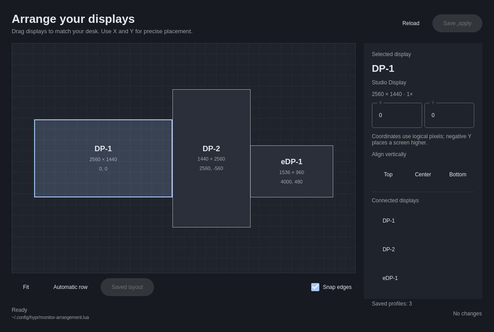

# Nier Monitor Arrangement



A standalone Quickshell editor for arranging Hyprland displays and remembering
layouts for each connected monitor combination. Drag the screens, edit exact
X/Y coordinates, align their top/center/bottom edges, then **Save & apply**.
Positions use logical pixels, including negative X/Y. Mode, scale, transform,
refresh rate and other monitor settings are preserved.

## Run from source

Requirements: Go 1.23+, Bash, Quickshell, a Lua-enabled Hyprland, and Lua 5.4+.
No third-party Go dependencies or JSON/YAML Lua modules are needed.

```bash
bin/build
bin/nier-monitor-arrangement open
```

To enable saved-profile matching at startup and on monitor connection/removal:

```bash
bin/nier-monitor-arrangement enable
```

The enable command backs up `~/.config/hypr/monitors.lua`, adds a managed loader,
and validates Hyprland after reloading it. It replaces only the earlier
Nier automatic-order block when present, preserving the other monitor rules.
On a config error it restores the original. Keep the source directory in place
when using a development installation. Packaged installations use stable paths
under `/usr/share/nier/`.

## Saved arrangements

The editor stores a returned Lua table in:

```text
~/.config/hypr/monitor-arrangement.lua
```

Example with fictional serials:

```lua
return {
  ["EXTERNAL-01:LAPTOP-01"] = {
    ["EXTERNAL-01"] = { x = 0, y = -300 },
    ["LAPTOP-01"] = { x = 2560, y = 0 },
  },
  ["LAPTOP-01"] = {
    ["LAPTOP-01"] = { x = 0, y = 0 },
  },
}
```

Profile keys contain sorted monitor identities joined by `:`. They do not depend
on discovery order or connector names when serials are unique. Each identity is
the serial, or `model=<model>` if the serial is absent or a placeholder such as
`unknown` or `0`. A missing model falls back to the display description.
Identical serials or model identities acquire an `@<connector>` suffix to break
the tie; these ambiguous profiles depend on connector names remaining the same.
Delimiter characters inside identities are percent-escaped so keys cannot collide.
Mirrored and disabled displays are excluded; the editor arranges independent,
active outputs.

Saving preserves all other profiles, checks for a changed monitor set, resolution,
scale or profile file, rejects overlapping screens, and writes atomically. Each
changed existing file gets a private `monitor-arrangement.lua.before-*` backup.
Saved Lua is data only: the reader runs it with an empty environment, an
instruction limit, a timeout and schema checks. Profiles can contain tables and
numbers; they cannot call `os`, `io`, or other runtime APIs.

If applying fails, the editor explicitly reports **Saved, but could not apply**.
The saved profile remains available for correction. Actual monitor positions are
checked after application instead of assuming that accepted Lua syntax means
the layout changed. If all displays are asleep, accepted rules are reported as
queued until wake rather than falsely reported as applied or failed.

## Hyprland integration

The small `hypr/runtime.lua` loader schedules the backend on startup, config
reload and monitor added/removed events, coalescing event bursts for 200 ms. The
same Go matching code serves the editor and runtime, avoiding differences between
Lua monitor objects and the richer `hyprctl monitors -j` metadata. The profiles
file itself remains a normal Lua table that can be inspected with Lua.

A matching profile is applied automatically. Otherwise the fallback places
external screens left to right in discovery order, followed by `eDP-1`. Discovery
state lives in `$XDG_RUNTIME_DIR/nier-monitor-arrangement/` (or the user cache if
there is no runtime directory). Disconnecting removes an output from that order;
reconnecting discovers it anew. If the laptop is off, only active external
screens are arranged. Invalid saved profiles report an error and are not silently
replaced with a different layout.

Keep other monitor-position automation disabled: concurrent rules or services
can override the arrangement. Your resolution and scale rules should remain
above the managed loader in `monitors.lua`.

## Commands and shortcuts

| Command | Purpose |
|---|---|
| `nier-monitor-arrangement open` | Open the editor; also the default action |
| `nier-monitor-arrangement snapshot` | Read active monitors/profile metadata as JSON |
| `nier-monitor-arrangement save` | Read a snapshot-based save request as JSON on stdin |
| `nier-monitor-arrangement apply` | Apply the matching saved profile or automatic fallback |
| `nier-monitor-arrangement enable` | Install the per-user Hyprland loader with backup |

The backend emits JSON with an `ok` field, error text and a nonzero exit code on
failure. `snapshot` is read-only. To use a temporary profile file in a test, set
`NIER_MONITOR_ARRANGEMENT_FILE`; the GUI and backend share this override.

| Shortcut | Action |
|---|---|
| Ctrl+S | Save and apply |
| Ctrl+R | Reload the live layout, asking before discarding edits |
| Ctrl+Q | Quit, asking before discarding edits |
| F | Fit all displays in the preview |

The window follows Omarchy theme colors and language changes. English is the
fallback; a Danish catalog is included. Dynamic monitor labels use plain text.

## Package and validation

```bash
bin/test
bash tests/enable.sh
bash tests/interaction.sh
bash tests/gui-smoke.sh
bin/package
sudo pacman -U dist/nier-monitor-arrangement-*.pkg.tar.zst
nier-monitor-arrangement enable
```

The package installs commands in `/usr/share/nier/bin/` with `/usr/bin` symlinks,
read-only QML/runtime assets in `/usr/share/nier/plugins/nier.monitor-arrangement/`,
and a normal app-launcher desktop entry using the selected desktop-and-laptop SVG icon. Package construction generates a local
source archive and pins its SHA-256 in the rendered PKGBUILD. It does not publish
anything or modify user configuration automatically.

Tests cover identity matching, delimiter escaping, duplicate models, scale and
rotation, overlaps, stale edits, Lua decoding limits, atomic saves/backups,
multiple profiles, fallback ordering and failed application. Go tests use fake
Hyprland commands and disposable directories. GUI previews use fictional screens:

```bash
quickshell -p qml/preview.qml
```

Physical hotplug and multi-dock behavior require validation on real hardware.
